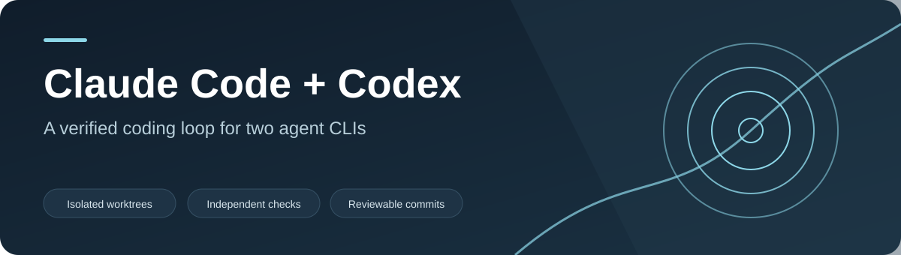

[](https://github.com/nin-dev-ai/claude-codex-loop-harness/actions/workflows/verify.yml)

# Claude Code & Codex Loop Harness — verified AI coding agents in Git worktrees

Claude Code & Codex Loop Harness is a local Python controller for **Claude Code CLI** and **OpenAI Codex CLI** tasks. Give it an approved task and project-specific checks; it runs the selected agent in an isolated Git worktree, verifies the result outside the agent session, and commits passing work to a reviewable task branch. It does not merge or deploy.

Use it when you want a repeatable **AI coding loop** with explicit approval, independent tests, bounded retries, and a clear audit trail instead of a one-shot prompt.

## How the loop works

`discover → plan → execute → verify → iterate → commit`

- **Isolate work:** one task, one branch and worktree; failed attempts remain available for inspection.
- **Check results independently:** your lint, type checks, tests, and acceptance commands decide whether work passes.
- **Keep control:** only approved tasks run, repeated failures stop the loop, and a passing result still awaits your review.

This repository is a **copy-into-your-project template**, not a hosted service or a Python package. It requires Python 3.9+, Git, and an installed Codex CLI or Claude Code CLI.

## Start a project

1. Copy this repository's harness files into a Git project. Use Python 3.9+ and install [Codex CLI](https://developers.openai.com/codex/cli/) or [Claude Code CLI](https://code.claude.com/docs/en/setup).
2. Edit `PROJECT_KNOWHOW.md`. Keep secrets out of it.
3. Run `python3 scripts/bootstrap.py` to preview affected documents and a unified diff. Review the proposal, then run `python3 scripts/bootstrap.py --apply`. Bootstrap updates only marked generated sections, records source and output hashes, rejects edits to those sections since the last sync, and appends to `.loop/CHANGELOG.md`.
4. Review the PRD, architecture, design, and task seeds. Use `BOOTSTRAP_PROMPT.md` with your chosen agent for deeper planning. Put **approved** executable tasks in `.loop/tasks.json`; the Markdown task seeds alone are not executable.
5. Replace `.loop/config.json` verification commands with your real project checks. Commands are argv arrays; no shell interpretation occurs. Include lint, type checks, unit tests, and acceptance or regression commands relevant to the project. Python, Node.js, and TypeScript tools all work as commands. An empty or missing command list fails closed.
6. Commit the project setup. Run `python3 scripts/loop.py doctor --agent codex` or `python3 scripts/loop.py doctor --agent claude`, then `bash scripts/verify.sh`.
7. Run `python3 scripts/loop.py run --agent codex --mode build` or `python3 scripts/loop.py run --agent claude --mode build`. Modes are `build`, `repair`, and `improve`. Codex is the default if `--agent` is omitted. Use `--task TASK-001` to choose an eligible task. Use `--resume` for an interrupted run; it remembers the selected agent.

The included configuration verifies **this harness** with its Python tests. Replace it when copying the harness into another project.

`AGENTS.md` contains repository instructions for Codex; `CLAUDE.md` mirrors them for Claude Code. Keep both files aligned when adapting the template. Claude Code runs in print mode with automatic file edits; its shell commands still follow Claude's permission rules. The controller performs verification separately either way.

## Task format

```json
[
  {
    "id": "TASK-001",
    "title": "Add a health endpoint",
    "mode": "build",
    "approved": true,
    "depends_on": [],
    "acceptance": ["GET /health returns 200 in the acceptance test"]
  }
]
```

Task modes are `build`, `repair`, and `improve`. Dependencies must be completed first. An improve task also requires `benchmark: {"command": ["python3", "bench.py"], "baseline": 1.5, "direction": "min"}`. The command must print one numeric value; the new value must strictly improve on the recorded baseline. Use reproducible inputs and commit the benchmark source.

## Runtime and review

`.loop/config.json` controls per-attempt timeouts, total elapsed time, attempt count, output size, verification commands, and protected paths. Attempts store separate stdout and stderr plus metadata in ignored `.loop/runs/`. `.loop/state.json` records progress and the last verified commit; `.loop/PROGRESS.md` records outcomes. The controller stops on identical repeated verification failures. It retains failed worktrees for inspection. A successful run leaves a committed task branch and worktree for review.

The verifier checks bootstrap consistency, task/config/state schemas, and every configured project command. Existing test files and protected requirements cannot be changed by an automated task. New tests may be added. Review code and results before creating a pull request.

GitHub Actions runs the same gate on pushes and pull requests. The **Manual repair** workflow accepts an approved repair task ID and agent choice, runs the controller, pushes its verified branch, and opens a pull request. Configure `OPENAI_API_KEY` for Codex runs or `ANTHROPIC_API_KEY` for Claude Code runs as a repository secret. Repository Actions settings must permit pull request creation by `GITHUB_TOKEN`. It does not merge.

## Limits

Bootstrap is deterministic scaffolding. It reports changed sections, generated-section conflicts, and unresolved placeholders. Detailed semantic conflicts and architectural decisions require human review with `BOOTSTRAP_PROMPT.md`. A passing command suite proves only the checks configured for that project.

## Documentation and help

- [Product requirements](docs/PRD.md), [architecture](docs/ARCHITECTURE.md), and [design notes](docs/DESIGN.md)
- [Task and loop contract](.loop/LOOP.md), [Codex instructions](AGENTS.md), and [Claude Code instructions](CLAUDE.md)
- [Open an issue](https://github.com/nin-dev-ai/claude-codex-loop-harness/issues) for bugs or setup questions

Maintained by [nin-dev-ai](https://github.com/nin-dev-ai). Licensed under [MIT](LICENSE).
